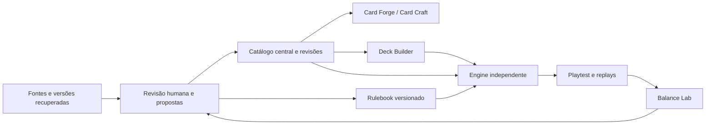

# STAR HILL — proposta de arquitetura

**Proposta para revisão, não implementação.** Base: vanilla JS do editor e do playtest, JSON central, servidor local Python e contratos de teste já existentes. O nome STAR HILL foi confirmado pelo usuário neste chat em 22/10/2026.

## Organização e reaproveitamento

Manter uma aplicação web local, sem build obrigatório, com módulos ES. A primeira entrega reaproveita Card Forge, templates, IDs e catálogo; não reconstrói a identidade visual nem troca o framework. A evolução da engine deve partir da análise do trabalho concorrente em `playtest/engine.js`, preservando o jogo publicado e sem editar `playtest/` no escopo atual.

Uma pasta futura `star-hill/` hospeda navegação, catálogo, Rulebook, decks e relatórios. `card-forge/` permanece como editor integrado por adaptadores. Pastas futuras `shared/` e `engine/` concentram contratos e regras executáveis. Estes caminhos são sugestões, não arquivos criados nesta fase.

## Banco compartilhado e preservação

`data/cards.json` continua sendo a fonte operacional existente até uma migração aprovada. O primeiro passo é um modelo compartilhado e validação, mantendo os campos internos em português. Acrescentar informações de proveniência, versões e aprovação em registros complementares; não reinterpretar `status: art-ready` como APPROVED.

Separar identidade (`id` imutável), revisão do conteúdo, estado editorial, estado visual e cobertura de implementação. Uma revisão referencia sua antecessora, origem, autor, data, justificativa e aprovação explícita. Impressão/arte, implementação mecânica e texto de habilidade mantêm vínculos verificáveis. Campo ausente continua vazio; `false` de Cosmoble não se confunde com desconhecido/não aplicável.

Usar arquivos JSON versionados e escrita atômica na fundação local, com comparação da revisão esperada para impedir sobrescrita de edições concorrentes. Somente ampliar para SQLite via biblioteca padrão do Python quando volume, consultas ou concorrência justificarem a migração. Nessa migração, catálogo e histórico passam juntos para uma única fonte transacional, e JSON vira projeção/exportação reproduzível; não manter dois bancos editáveis independentes.

As gravações aprovadas do catálogo atual continuam passando por `serve.py/upsert_card`. Evoluir o protocolo para proposta→diff→aprovação→gravação, validando esquema e revisão no servidor. Hoje o diff depende da interface; a API não registra aprovação, histórico nem revisão esperada. Não expor esse servidor local publicamente.

## Rulebook como contrato

Cada regra aprovada terá ID estável, revisão, texto, seção/origem, estado de confirmação e relações com outras regras. Os IDs recuperados no relatório são candidatos, não uma migração aplicada. Uma versão publicada do Rulebook é imutável; alterações geram outra versão e um changelog explícito.

Uma partida fixa versão do Rulebook, revisões das cartas e versão da engine. Atualizar o manual não muda uma partida salva nem reinterpreta silenciosamente uma carta. Regras de texto livre não viram código por interpretação automática. Lacunas impedem somente a interação que depende delas e produzem erro/pêndencia explícito; não há resolução aproximada.

## Engine determinística

Reaproveitar os resolvers verificados do legado, mas substituir o acoplamento de texto/nome por um registro explícito de implementações: habilidade ID/revisão → handler validado → testes e regras de origem. Recursos, alvo, custo, condição e efeito são dados estruturados. Texto inglês impresso permanece preservado e relacionado à implementação.

O contrato proposto recebe estado serializável, comando e contexto de versões; devolve próximo estado, eventos e escolhas pendentes. RNG é injetado e sua semente/algoritmo são registrados. Identificadores de instância vêm de contador serializado. Relógio real, DOM, áudio, timers e animação ficam na apresentação. Escolhas pendentes e pilha usam descritores, não closures serializáveis por suposição.

Cada evento mecânico identifica tipo, índice sequencial, ação causadora, fonte, controlador/dono quando aplicável, alvos, custo pago e regra/habilidade que o gerou. Eventos visuais podem ser derivados desses eventos, mas nunca decidir seus resultados.

Replay inclui estado inicial, ordem dos decks, comandos, escolhas, pagamentos, eventos e estado final; guarda hashes e todas as versões necessárias. Reexecutar deve produzir os mesmos eventos e hash final. O log textual atual não cumpre esse contrato.

## Interfaces e exportação

Navegação da STAR HILL: Home, Cards, Card Craft, Rulebook, Deck Builder, Playtest, Balance Lab, Changelog e Settings. Dashboard separa cartas recuperadas, revisão, aprovação, arte e cobertura mecânica; não exibe métricas inexistentes como zero de defeitos. Estado inicial não afirma que 57 cartas estejam aprovadas.

Card Craft compartilha o mesmo modelo do catálogo, incluindo Cosmoble e estados não aplicáveis. Cloth/Scale/Weapon continuam relacionados ao sistema de tipos existente até decisão de taxonomia; não inventar um layout de Scale ou Location para preencher lacunas. Templates seguem os PSDs e a direção já estabelecida.

JSON/CSV preservam arrays e texto multilinha com convenção reversível documentada. XLSX exige uma dependência de leitura/escrita previamente avaliada, sem serviço pago. Toda importação entra em staging com relatório de ambiguidades e conflitos; não sobrescreve uma revisão aprovada. PNG individual e lote são reaproveitados; ZIP pode usar `zipfile` do Python. PDF de impressão precisa primeiro de decisões de tamanho, sangria e marcas e de verificação visual. Não existe requisito aprovado para escolher esses parâmetros por conta própria.

Deck Builder usa catálogo e Rulebook fixados: tamanho, cópias, God/Domain separados e cores validadas. Curva de custo, tipos e proporção Cosmoble são estatísticas; alertas de consistência não são proibições de regra. Nenhum limiar numérico de alerta foi inventado nesta proposta.

Playtest começa local: humano×humano, humano×IA e IA×IA somente com conjunto de habilidades coberto. IA pede as mesmas ações legais que um humano; não burla custos nem escolhe automaticamente interações sem implementação. Balance Lab registra versão, seed, política de IA e amostra de cada comparação. Ciclos precisam de orçamento de ações e diagnóstico de estado/eventos repetidos, sem declarar matematicamente inexistente todo combo infinito.

## Testes, permissões e dependências

Reutilizar `node:test`/assert e os cenários atuais, com fixtures e replays sem DOM. Cobrir integridade de IDs/referências, decks, custos, recursos, combate, Seal, ETB, destruição/zonas, equipamentos/Resonance, Awaken, Ultimate e vitória; complementar com importação/exportação e preservação byte a byte de texto e de blocos não alterados. A suíte atual é evidência inicial e contém interpretações a confirmar, não especificação superior ao manual.

Não há RBAC nem conta de usuário na aplicação local atual. A fundação precisa proteger a transição de aprovação mesmo localmente e manter trilha de auditoria. Se houver múltiplos usuários no futuro, papéis e autorização pertencem ao servidor, não apenas aos botões. Backend online, autenticação, multiplayer e hospedagem são decisões posteriores e dependem de autorização específica.

Dependências imediatas: navegador moderno, JS, Python stdlib e Node para testes. `psd-tools` é ferramenta de extração, não dependência do editor em execução. Não introduzir framework, bundler, ORM, banco remoto ou serviço pago nesta fase.
